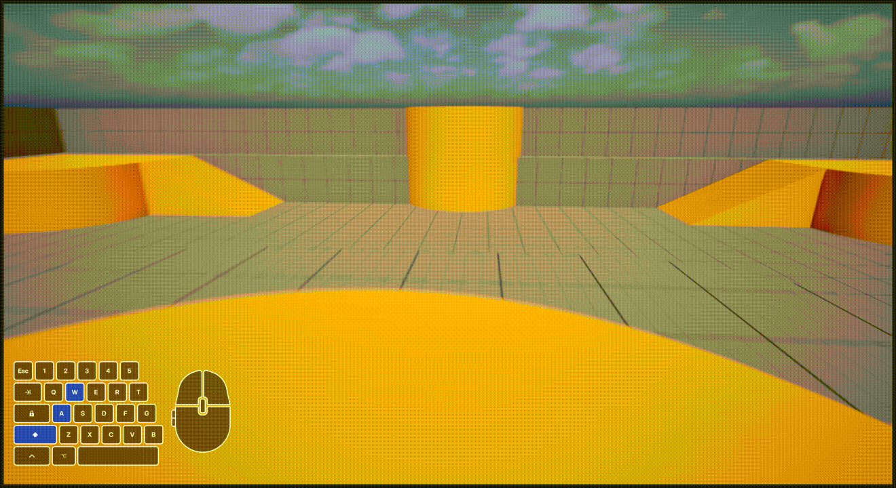

# Strider — Character Controller

Strider is my character controller demo featuring mouse-controlled first-person observation, WASD movement,
jumping, and a key-press duration charge slide.

 

**Watch the full [demo](https://www.youtube.com/watch?v=QWYrC0kRBz0)**

## Build

- Unreal Engine 5.7~~~~
- Clone, right-click `CharacterController.uproject` → Generate Visual Studio project files
- Open in Rider or the editor and build the `CharacterController` target

## Features

- First-person character controller (Enhanced Input)
- Charged slide — distance and friction scale with hold duration

#### Controls List:

- WASD - Movement
- Mouse - Look
- Hold Shift - Charge up dash
- Release Shift - Dash
- Spacebar - Jump

## Design decisions

### Extending UCharacterMovementComponent instead of a custom APawn
I considered taking on the task of building basic character movement from the ground up, but ultimately
the undertaking would've taken away from the primary goal of this project. Instead of fabricating a movement system from the bottom up i.e. building custom APawn, extending UCharacterMovementComponent separates a lot of the minutiae that come with reinventing the wheel:
- step-up onto ledges
- slope limits
- movement states
- penetration resolution

This option brings with it an opportunity to append a new feature to a larger system, I myself didn't write, while still 
having to understand fundamentals of the movement system. 

### Staying in MOVE_Walking instead of MOVE_Custom
Implementing a MOVE_Custom was another path that crossed my mind at first as theoretically elements such as 
ground friction and speed would differ when sliding/crouch-sliding vs. walking. Alternatively, another approach would be to
derive any physics elements within MOVE_Walking when sliding. The latter was chosen as the stronger engineering path, invoking Occam’s razor by offering a more concise yet equally effective solution.

### Deriving per-frame values instead of mutating members
I chose to derive functions that handled ground-friction, speed, and other physics when found in a "sliding" as 
opposed to directly mutating members of UCharacterMovementComponent. This was preferred for being the safer and more design conscious path to what I wanted to achieve in its simplest form.
Otherwise, I would have to save and restore said members in FSavedMove_Character which could lead to a client being permanently
altered after a correction.

### Accumulating DeltaTime instead of timestamps
DeltaTime was always the most robust way for representing charge when taking into consideration network prediction/ error handling.
Player-input based timestamps are less reliable whereas using accumulation allows the use of replayability to calculate the original amount of intended charge time.

### Sending one intent bit
This is also why I will be sending one intent bit through client-server which leaves the task of calculating the sum amount of charge to the server.
This removes any doubt of the reported client-reported charge being tampered with whether intentional or by happenstance.

## Known limitations / next steps

- Crouching/CrouchSliding has yet to be implemented
- Network-prediction must be implemented (FSavedMove_Character)
- Camera work/animation when charging slide/sliding
- Friction should be tweaked higher